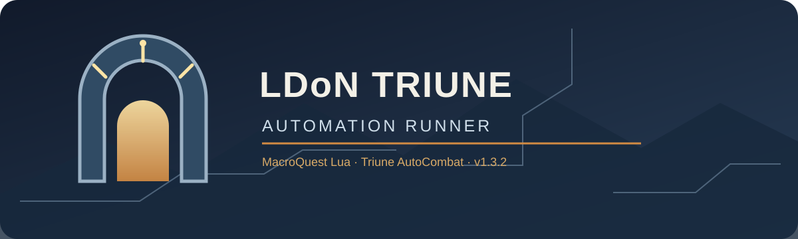

# Stylized LDoN Automation Lua Script

MacroQuest Lua automation for Lost Dungeons of Norrath (LDoN) campaigns, with
Triune AutoCombat integration.

**Current release: v1.4.7**

## What it does

- Requests hard-difficulty mob-count missions by default.
- Provides an in-game window to set campaign camps, dungeon counts, the mission
  type and your group's roles.
- Supports solo runs and grouped runs. Start from whichever character you want
  to run the mission; it does not have to be the group leader.
- Lets you choose a **Main Tank**, **Main Assist** and **Puller** in the **Group
  roles** window, then sets up every box through Triune AutoCombat.
- Brings your boxes along: they follow your character to the dungeon door.
- Can be started from anywhere and at any stage of an adventure.
- Travels among supported LDoN hubs and dungeons and manages campaign legs.
- Includes navigation diagnostics and safe recovery helpers for reported mesh
  failures. It does not download or edit navmesh files.

See [GETTING_STARTED.md](GETTING_STARTED.md) for beginner installation
instructions and [GUIDE.md](GUIDE.md) for the full feature and usage guide.
Version history is in [CHANGELOG.md](CHANGELOG.md).

## Requirements

| What | Needed for | How to check |
| --- | --- | --- |
| MacroQuest with Lua and ImGui | Everything | `/lua run LDON_Triune` opens the window |
| **MQ2Nav** plugin and zone navmeshes | All travel. The runner will not start without the plugin | `/plugin MQ2Nav`, then `/ldon preflight` |
| **MQ2MoveUtils** plugin | Zone crossings and walking fallbacks. The runner will not start without it | `/plugin MQ2MoveUtils` |
| **Triune AutoCombat** ([tunaria/TriuneAutocombat](https://github.com/tunaria/TriuneAutocombat)) | Combat in dungeons | `/lua run triune` |
| **BoxNet** (built into Triune AutoCombat) | Grouped runs only | `/ac net peers` lists your boxes |
| **Bazaar and Back** AA 331 | Starting a solo run, and reaching your first camp from outside LDoN. Grouped returns use the dungeon exit without it, and a solo return falls back to the exit if the AA is not ready within three minutes | Check your AA window |

BoxNet needs the MacroQuest launcher running and, on every box, its
**Also run other slash commands** setting turned on. The grouped preflight line
**BoxNet transport plugin loaded** looks for MQ2EQBC or MQ2DanNet, which BoxNet
does not use, so you can ignore that line if `/ac net peers` lists your boxes.

**Optional extras.** The first four stay off until you enable them in the window. Camp artwork has no switch; it shows whenever the folder is present.

| Extra | What it adds | What you need |
| --- | --- | --- |
| Shrink once on every zone entry | Attempts one click of a shrink item in each zone | `ldon_shrink.lua` beside the runner on every box, and a Wand of Imperceptibility, Bracelet of the Shadow Hive or Shimmering Bauble of Trickery |
| Long-Duration Buffs | Sends `/ac longbuff on` as combat starts | `lua/tac/long_buffs.lua`, `lua/tac_long_buffs_store.lua` and a roster built in Triune (Settings > Plugins > Long-Duration Buffs) |
| Swarm Pull | Pulls groups of mobs | `lua/tac/Swarm_Pull_v2.0.lua` or `lua/tac/swarm_pull.lua` |
| Group follow and recorded routes | Boxes follow your character to the dungeon, and you can record paths for trouble spots | **MQ2AdvPath** plugin (`/plugin MQ2AdvPath`). Without it, boxes walk the entrance route themselves |
| Camp artwork | Window backgrounds | `ldon_art` folder beside the runner. The images are not in the release archives, and the window works without them |

Dependencies and navmeshes are **not included** in the release archives.

## Quick start

1. Copy `LDON_Triune.lua` into MacroQuest's `lua` folder. For the optional
   shrink on every zone entry, also copy `ldon_shrink.lua` there on every box;
   regular and tiered shrink items are supported. See the guide for BoxNet
   requirements.
2. Stand anywhere. In a supported LDoN camp or instance the runner starts right
   there; from any other zone it travels to your first camp using Bazaar and
   Back and the Magus.
3. Run `/lua run LDON_Triune` in the MacroQuest console.
4. Set your camps and press **Group roles...** in the runner window, then run
   `/ldon preflight` to check your setup, and start.

Common commands: `/ldon start`, `/ldon pause`, `/ldon finish`, `/ldon exit` and
`/ldon help`. The full list is in [GETTING_STARTED.md](GETTING_STARTED.md).

The supplied ZIP and TAR.GZ archives contain the runner, the optional shrink
helper, beginner instructions, feature guide, changelog, and project artwork.
That artwork is for documentation and branding only; it is not required by the
Lua script.

## Compatibility note

The TAR.GZ package is provided for users who prefer Linux archive tools. It
does not imply native Linux support: EverQuest and MacroQuest runtime
compatibility on Linux (including Wine setups) has not been tested or verified.

## Artwork and link previews

The repository's `branding` folder contains the original 1280 × 640 social-preview image
for this repository, matching artwork for the Triune Long Buffs project, and
the DeFluxStudios profile banner. These images are presentation assets only;
they are not loaded by the Lua runner. GitHub's hover-card layout is fixed,
but repository social-preview images customize the artwork shown in rich link
previews.

## Credits and attributions

- **Cannonballdex and the contributors credited in LDON.mac** (TreeHuginDruid,
  CWTN, earthsnemesis, Kaen01 and others on the RedGuides forums): additional
  entrance coordinates and named doors were cross-checked against the macro.
  Triune-specific routes remain where they differ; the macro itself is not
  bundled.
- **Cyfer**: LDoN mission and travel reference details were adapted from Cyfer's
  `LDON.lua`. The original reference material is not included in this repository.
- **DeFluxStudios**: the MacroQuest Lua runner, including the campaign scheduler,
  Triune AutoCombat integration, configuration UI and navigation recovery.
- **DeFluxStudios** also wrote the Long-Duration Buffs plugin (`long_buffs.lua`,
  `tac_long_buffs_store.lua`), which the runner can optionally enable.
- **matth** wrote the Swarm Pull plugin, a Lua port of `pull.mac`, which the
  runner can optionally start.
- **A_Enchanter_00** wrote MQ2AdvPath, hosted by **RedGuides**, which is optionally
  used for recorded routes.
- None of those three plugins is included in this repository or release.
- **MacroQuest**, **Triune AutoCombat**, **MQ2Nav**, and **MQ2MoveUtils** are
  separate upstream projects and are required dependencies; they are not
  included in this repository or release.

## Project

- Repository: <https://github.com/DeFluxStudios/Stylized-LDON-Automation-LUA-Script>
- Releases: <https://github.com/DeFluxStudios/Stylized-LDON-Automation-LUA-Script/releases>
